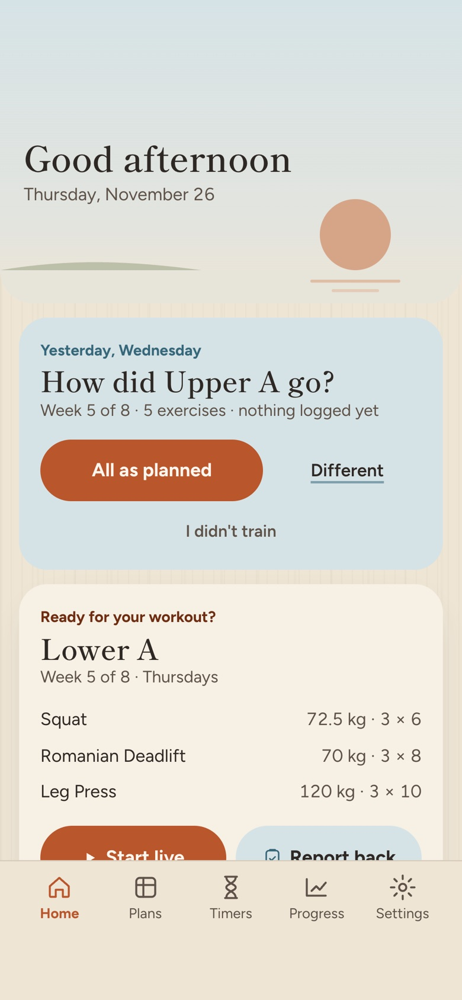
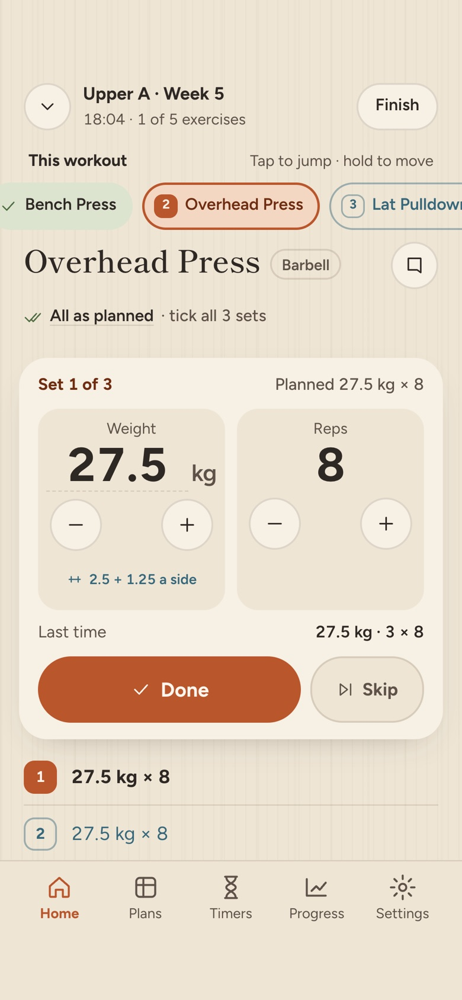
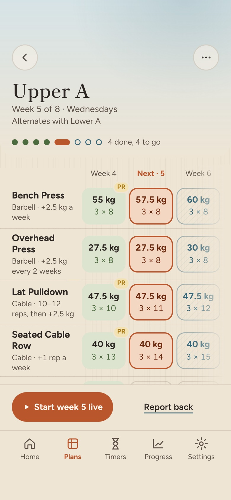
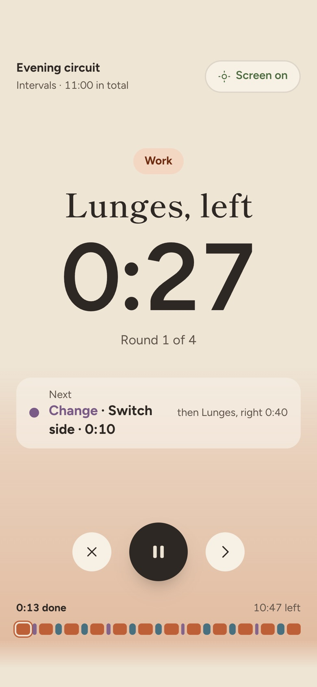

  

<b>A free workout logger with interval timers built in.</b> For iPhone and Android, in English and Finnish.

<a href="https://haapa.app"><b>haapa.app →</b></a> · <a href="https://haapa.app/fi/">Suomeksi →</a>

  <picture><source media="(prefers-color-scheme: dark)" srcset="img/home-dark.jpg"></picture>
  <picture><source media="(prefers-color-scheme: dark)" srcset="img/logging-dark.jpg"></picture>
  <picture><source media="(prefers-color-scheme: dark)" srcset="img/grid-portrait-dark.jpg"></picture>
  <picture><source media="(prefers-color-scheme: dark)" srcset="img/timer-dark.jpg"></picture>

Haapa is a workout logger that is free and has no limits: as many routines, exercises, and workouts as you like, and all of your history. It tracks your progress without overthinking it: pick a rule once (add 2.5 kg a week, add a rep, or climb a rep range), and Haapa plans the weeks ahead. Rest, HIIT, and interval timers are built in, so one app covers the whole session. *Haapa* is Finnish for "aspen".

**Coming in early 2027, to the App Store and Google Play at the same time.**

## What's inside

- **Log a set in a few taps.** Your planned weight and reps are filled in. Change what went differently, then tap Done.
- **The progression grid:** your plan, like a spreadsheet. Exercises in rows, weeks in columns. Enter week 1, pick your rule (add 2.5 kg a week, add a rep, or climb a rep range), and Haapa fills in the weeks after it. Change any cell by hand.
- **Timers in the same app:** rest between sets, HIIT, and your own intervals, with beeps, gongs, vibration, and a 3-2-1 before every change. They work with the screen locked.
- **See how you're doing:** estimated 1RM, best sets, and a quiet tag when you beat a record.
- **A plate calculator** that tells you what to put on each side of the bar.
- **Share your plan** as a QR code or a file, or start one in Excel.

## Free and private

- **100% free.** No ads, no subscriptions, no paywalls, and no in-app purchases. Every feature, with no limits.
- **No limits.** Unlimited routines, exercises, workouts, and history.
- **No account.** Open it and start.
- **No tracking.** No analytics, no crash reporters, and no ad networks.
- **No network.** The app never goes online, so it works the same in a basement gym with no signal.
- **Your data is yours.** Back up to one file, or export every set to a spreadsheet (CSV) at any time.

[Privacy policy →](https://haapa.app/privacy.html) · [Why Haapa and not another app? →](https://haapa.app/why.html) · [CSV format →](https://haapa.app/csv-format.html)

## About this repository

This repository holds only the website, [haapa.app](https://haapa.app): plain HTML and CSS, with no scripts, cookies, or analytics, and no requests to anyone else (the fonts and images are all here). GitHub Pages serves it. The app's source is kept elsewhere.

Questions or feedback: [hello@haapa.app](mailto:hello@haapa.app)

---

© 2026 Haapa. All rights reserved. The fonts, Figtree and Shippori Mincho, are under the SIL Open Font License (see `fonts/`).
